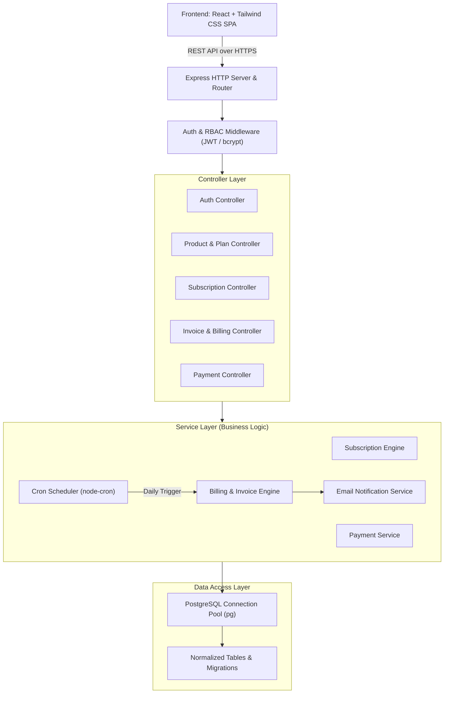
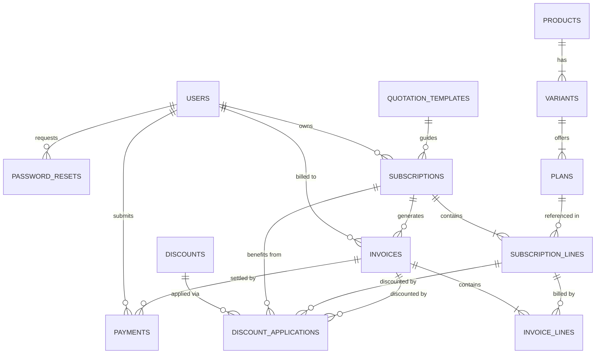
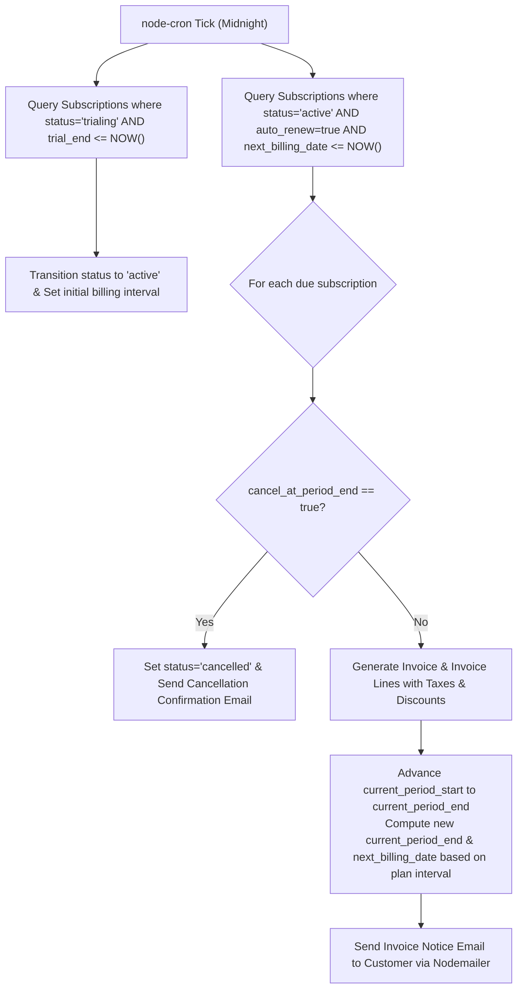

# SUBNEX – Subscription Management System
> **Tagline:** One Platform. Every Subscription. Complete Control.  
> **Document:** Master Architectural Blueprint & Implementation Plan  
> **Status:** PROMPT 0 – Planning & Project Setup  

---

## 1. Executive Summary & Problem Statement

Modern businesses and digital platforms face significant challenges managing recurring revenues, customer lifecycles, and multi-tier pricing structures:
- Fragmented billing lifecycles (trials, renewals, proration, cancellations, and pauses).
- Complex product catalogs with multi-dimensional variants and plans.
- Disconnected invoicing, discounting, tax calculations, and payment tracking.
- Manual intervention required for recurring invoice generation and payment failure handling.

**SUBNEX** is an end-to-end Subscription Management Platform designed to streamline the entire subscription journey—from product catalog and quotation templating to automated recurring billing, invoicing, payments, and customer account self-service.

---

## 2. Tech Stack Overview

| Component | Technology | Purpose |
| :--- | :--- | :--- |
| **Frontend** | React (Vite) + Tailwind CSS | Responsive, accessible customer portal and administrative dashboards. |
| **Backend** | Node.js + Express | RESTful API server with modular layered architecture. |
| **Database** | PostgreSQL (Relational) | ACID-compliant storage with normalized tables, constraints, and indexes. |
| **Authentication** | JWT (JSON Web Tokens) + bcrypt | Stateless auth with role-based access control (RBAC) and secure password hashing. |
| **Email Service** | Nodemailer (SMTP / Transport) | Transactional emails for welcome, password resets, invoice generation, and renewals. |
| **Task Scheduling** | `node-cron` | Automated daily billing checks, invoice issuance, trial expiration, and overdue alerts. |

---

## 3. System Architecture

SUBNEX adopts a **Layered Monolithic Architecture** with clear boundaries between data access, business logic, API routing, and presentation.



---

## 4. User Roles & Permission Matrix

SUBNEX enforces Role-Based Access Control (RBAC) with three primary roles:

| Role | Description |
| :--- | :--- |
| **`admin`** | Full platform superuser: manages users, catalog, quotation templates, global taxes, discounts, invoices, and overrides. |
| **`staff`** | Operational staff: manages products, plans, reviews subscriptions, issues invoices, and monitors payment statuses. |
| **`customer`** | Subscriber / End-user: views subscribed plans, manages billing details, views invoices, and initiates payments or cancellations. |

### Permissions Matrix

| Feature / Resource | Endpoint Path Prefix | Customer | Manager | Admin |
| :--- | :--- | :---: | :---: | :---: |
| Self-Registration & Login | `/api/v1/auth/*` | ✅ | ✅ | ✅ |
| Password Reset Flow | `/api/v1/auth/reset-*` | ✅ | ✅ | ✅ |
| View Public Catalog (Products/Plans) | `/api/v1/products`, `/plans` | ✅ (Active only) | ✅ | ✅ |
| Manage Catalog (Create/Edit/Deactivate) | `/api/v1/products`, `/variants`, `/plans` | ❌ | ✅ | ✅ |
| Quotation Templates | `/api/v1/quotations` | ❌ | ✅ | ✅ |
| Create Own Subscription | `/api/v1/subscriptions` | ✅ | ✅ | ✅ |
| View Own Subscriptions | `/api/v1/subscriptions/my` | ✅ | ✅ | ✅ |
| View All Subscriptions | `/api/v1/subscriptions` | ❌ | ✅ | ✅ |
| Cancel / Pause Own Subscription | `/api/v1/subscriptions/:id/cancel` | ✅ | ✅ | ✅ |
| Configure Taxes & Discounts | `/api/v1/taxes`, `/api/v1/discounts` | ❌ | ❌ | ✅ |
| View Invoices (Own / All) | `/api/v1/invoices` | Own Only | ✅ | ✅ |
| Manual Invoice Trigger / Void | `/api/v1/invoices/:id/*` | ❌ | ✅ | ✅ |
| Submit Payment | `/api/v1/payments` | ✅ | ✅ | ✅ |
| Refund Payment | `/api/v1/payments/:id/refund` | ❌ | ❌ | ✅ |
| Manage System Users | `/api/v1/users` | ❌ | ❌ | ✅ |

---

## 5. Normalized PostgreSQL Database Schema



### Table Definitions & Constraints

#### 1. `users`
Stores user identities, credentials, profile details, and role assignments.
```sql
CREATE TYPE user_role AS ENUM ('customer', 'manager', 'admin');

CREATE TABLE users (
    id UUID PRIMARY KEY DEFAULT gen_random_uuid(),
    email VARCHAR(255) NOT NULL UNIQUE,
    password_hash VARCHAR(255) NOT NULL,
    full_name VARCHAR(150) NOT NULL,
    company_name VARCHAR(150),
    role user_role NOT NULL DEFAULT 'customer',
    phone VARCHAR(30),
    address_line1 VARCHAR(255),
    address_line2 VARCHAR(255),
    city VARCHAR(100),
    state VARCHAR(100),
    postal_code VARCHAR(20),
    country VARCHAR(2), -- ISO 3166-1 alpha-2
    is_active BOOLEAN NOT NULL DEFAULT TRUE,
    created_at TIMESTAMPTZ NOT NULL DEFAULT CURRENT_TIMESTAMP,
    updated_at TIMESTAMPTZ NOT NULL DEFAULT CURRENT_TIMESTAMP
);

CREATE INDEX idx_users_email ON users(email);
CREATE INDEX idx_users_role ON users(role);
```

#### 2. `password_resets`
Stores secure tokens for password recovery.
```sql
CREATE TABLE password_resets (
    id UUID PRIMARY KEY DEFAULT gen_random_uuid(),
    user_id UUID NOT NULL REFERENCES users(id) ON DELETE CASCADE,
    token_hash VARCHAR(255) NOT NULL,
    expires_at TIMESTAMPTZ NOT NULL,
    used_at TIMESTAMPTZ,
    created_at TIMESTAMPTZ NOT NULL DEFAULT CURRENT_TIMESTAMP
);

CREATE INDEX idx_password_resets_user ON password_resets(user_id);
CREATE INDEX idx_password_resets_token ON password_resets(token_hash);
```

#### 3. `products`
High-level service or product offerings.
```sql
CREATE TABLE products (
    id UUID PRIMARY KEY DEFAULT gen_random_uuid(),
    name VARCHAR(150) NOT NULL,
    type VARCHAR(50) NOT NULL DEFAULT 'service',
    sales_price NUMERIC(12, 2) NOT NULL DEFAULT 0.00 CHECK (sales_price >= 0),
    cost_price NUMERIC(12, 2) NOT NULL DEFAULT 0.00 CHECK (cost_price >= 0),
    notes TEXT,
    sku VARCHAR(50) NOT NULL UNIQUE,
    description TEXT,
    is_active BOOLEAN NOT NULL DEFAULT TRUE,
    metadata JSONB DEFAULT '{}'::jsonb,
    created_at TIMESTAMPTZ NOT NULL DEFAULT CURRENT_TIMESTAMP,
    updated_at TIMESTAMPTZ NOT NULL DEFAULT CURRENT_TIMESTAMP
);

CREATE INDEX idx_products_sku ON products(sku);
CREATE INDEX idx_products_active ON products(is_active);
```

#### 4. `variants`
Differentiators for a product (e.g., Tier: Starter, Pro, Enterprise, or Brand options).
```sql
CREATE TABLE variants (
    id UUID PRIMARY KEY DEFAULT gen_random_uuid(),
    product_id UUID NOT NULL REFERENCES products(id) ON DELETE CASCADE,
    name VARCHAR(150) NOT NULL,
    brand VARCHAR(100),
    additional_price NUMERIC(12, 2) NOT NULL DEFAULT 0.00 CHECK (additional_price >= 0),
    sku VARCHAR(60) NOT NULL UNIQUE,
    attributes JSONB NOT NULL DEFAULT '{}'::jsonb,
    is_active BOOLEAN NOT NULL DEFAULT TRUE,
    created_at TIMESTAMPTZ NOT NULL DEFAULT CURRENT_TIMESTAMP,
    updated_at TIMESTAMPTZ NOT NULL DEFAULT CURRENT_TIMESTAMP
);

CREATE INDEX idx_variants_product ON variants(product_id);
```

#### 5. `plans`
Pricing rules and recurrence schedules attached to a product variant.
```sql
CREATE TYPE billing_interval_type AS ENUM ('day', 'week', 'month', 'year');

CREATE TABLE plans (
    id UUID PRIMARY KEY DEFAULT gen_random_uuid(),
    variant_id UUID NOT NULL REFERENCES variants(id) ON DELETE CASCADE,
    name VARCHAR(150) NOT NULL,
    code VARCHAR(60) NOT NULL UNIQUE,
    billing_interval billing_interval_type NOT NULL DEFAULT 'month',
    billing_interval_count INT NOT NULL DEFAULT 1 CHECK (billing_interval_count > 0),
    trial_period_days INT NOT NULL DEFAULT 0 CHECK (trial_period_days >= 0),
    price NUMERIC(12, 2) NOT NULL CHECK (price >= 0),
    currency VARCHAR(3) NOT NULL DEFAULT 'USD',
    minimum_quantity INT NOT NULL DEFAULT 1 CHECK (minimum_quantity >= 1),
    available_from TIMESTAMPTZ,
    available_until TIMESTAMPTZ,
    allow_auto_close BOOLEAN NOT NULL DEFAULT FALSE,
    allow_pause BOOLEAN NOT NULL DEFAULT TRUE,
    allow_renewal BOOLEAN NOT NULL DEFAULT TRUE,
    allow_early_close BOOLEAN NOT NULL DEFAULT TRUE,
    is_active BOOLEAN NOT NULL DEFAULT TRUE,
    created_at TIMESTAMPTZ NOT NULL DEFAULT CURRENT_TIMESTAMP,
    updated_at TIMESTAMPTZ NOT NULL DEFAULT CURRENT_TIMESTAMP
);

CREATE INDEX idx_plans_variant_active ON plans(variant_id, is_active);
```

#### 6. `quotation_templates`
Reusable templates for quotes, terms, and custom proposals.
```sql
CREATE TABLE quotation_templates (
    id UUID PRIMARY KEY DEFAULT gen_random_uuid(),
    name VARCHAR(150) NOT NULL,
    code VARCHAR(60) NOT NULL UNIQUE,
    description TEXT,
    terms_and_conditions TEXT NOT NULL,
    default_validity_days INT NOT NULL DEFAULT 30 CHECK (default_validity_days > 0),
    is_active BOOLEAN NOT NULL DEFAULT TRUE,
    metadata JSONB DEFAULT '{}'::jsonb,
    created_at TIMESTAMPTZ NOT NULL DEFAULT CURRENT_TIMESTAMP,
    updated_at TIMESTAMPTZ NOT NULL DEFAULT CURRENT_TIMESTAMP
);
```

#### 7. `subscriptions`
Core subscription record managing billing schedules and lifecycle statuses.
```sql
CREATE TYPE subscription_status AS ENUM (
    'draft', 
    'trialing', 
    'active', 
    'past_due', 
    'paused', 
    'cancelled', 
    'expired'
);

CREATE TABLE subscriptions (
    id UUID PRIMARY KEY DEFAULT gen_random_uuid(),
    subscription_number VARCHAR(60) NOT NULL UNIQUE,
    customer_id UUID NOT NULL REFERENCES users(id) ON DELETE RESTRICT,
    quotation_template_id UUID REFERENCES quotation_templates(id) ON DELETE SET NULL,
    status subscription_status NOT NULL DEFAULT 'draft',
    currency VARCHAR(3) NOT NULL DEFAULT 'USD',
    
    -- Date and Lifecycle Control
    start_date TIMESTAMPTZ NOT NULL DEFAULT CURRENT_TIMESTAMP,
    trial_start TIMESTAMPTZ,
    trial_end TIMESTAMPTZ,
    current_period_start TIMESTAMPTZ NOT NULL,
    current_period_end TIMESTAMPTZ NOT NULL,
    next_billing_date TIMESTAMPTZ NOT NULL,
    billing_cycle_anchor TIMESTAMPTZ NOT NULL,
    
    -- State modifiers
    cancel_at_period_end BOOLEAN NOT NULL DEFAULT FALSE,
    cancelled_at TIMESTAMPTZ,
    pause_start TIMESTAMPTZ,
    pause_end TIMESTAMPTZ,
    auto_renew BOOLEAN NOT NULL DEFAULT TRUE,
    retry_count INT NOT NULL DEFAULT 0 CHECK (retry_count >= 0),
    
    notes TEXT,
    metadata JSONB DEFAULT '{}'::jsonb,
    created_at TIMESTAMPTZ NOT NULL DEFAULT CURRENT_TIMESTAMP,
    updated_at TIMESTAMPTZ NOT NULL DEFAULT CURRENT_TIMESTAMP,

    CONSTRAINT chk_period_validity CHECK (current_period_end >= current_period_start)
);

CREATE INDEX idx_subs_customer_status ON subscriptions(customer_id, status);
CREATE INDEX idx_subs_billing_lookup ON subscriptions(status, auto_renew, next_billing_date);
```

#### 8. `subscription_lines`
Items and quantities attached to a subscription.
```sql
CREATE TABLE subscription_lines (
    id UUID PRIMARY KEY DEFAULT gen_random_uuid(),
    subscription_id UUID NOT NULL REFERENCES subscriptions(id) ON DELETE CASCADE,
    plan_id UUID NOT NULL REFERENCES plans(id) ON DELETE RESTRICT,
    quantity INT NOT NULL DEFAULT 1 CHECK (quantity > 0),
    unit_price NUMERIC(12, 2) NOT NULL CHECK (unit_price >= 0),
    created_at TIMESTAMPTZ NOT NULL DEFAULT CURRENT_TIMESTAMP,
    updated_at TIMESTAMPTZ NOT NULL DEFAULT CURRENT_TIMESTAMP
);

CREATE INDEX idx_sub_lines_subscription ON subscription_lines(subscription_id);
```

#### 9. `taxes`
Configurable jurisdiction tax rates.
```sql
CREATE TYPE tax_rate_type AS ENUM ('percentage', 'flat');

CREATE TABLE taxes (
    id UUID PRIMARY KEY DEFAULT gen_random_uuid(),
    name VARCHAR(100) NOT NULL,
    rate NUMERIC(6, 3) NOT NULL CHECK (rate >= 0),
    tax_type tax_rate_type NOT NULL DEFAULT 'percentage',
    country VARCHAR(2), -- Optional regional targeting
    state VARCHAR(100),
    applicable_rules TEXT,
    is_active BOOLEAN NOT NULL DEFAULT TRUE,
    created_at TIMESTAMPTZ NOT NULL DEFAULT CURRENT_TIMESTAMP,
    updated_at TIMESTAMPTZ NOT NULL DEFAULT CURRENT_TIMESTAMP
);
```

#### 10. `discounts`
Promo codes, coupons, and promotional incentives.
```sql
CREATE TYPE discount_type_enum AS ENUM ('percentage', 'fixed_amount');
CREATE TYPE discount_target_scope AS ENUM ('subscription', 'plan', 'invoice', 'product');

CREATE TABLE discounts (
    id UUID PRIMARY KEY DEFAULT gen_random_uuid(),
    code VARCHAR(50) NOT NULL UNIQUE,
    name VARCHAR(100) NOT NULL,
    discount_type discount_type_enum NOT NULL,
    value NUMERIC(12, 2) NOT NULL CHECK (value > 0),
    min_purchase_amount NUMERIC(12, 2) NOT NULL DEFAULT 0.00 CHECK (min_purchase_amount >= 0),
    min_quantity INT NOT NULL DEFAULT 0 CHECK (min_quantity >= 0),
    max_redemptions INT,
    times_redeemed INT NOT NULL DEFAULT 0 CHECK (times_redeemed >= 0),
    valid_from TIMESTAMPTZ,
    valid_until TIMESTAMPTZ,
    target_scope discount_target_scope NOT NULL DEFAULT 'subscription',
    product_id UUID REFERENCES products(id) ON DELETE SET NULL,
    is_active BOOLEAN NOT NULL DEFAULT TRUE,
    created_at TIMESTAMPTZ NOT NULL DEFAULT CURRENT_TIMESTAMP,
    updated_at TIMESTAMPTZ NOT NULL DEFAULT CURRENT_TIMESTAMP
);

CREATE INDEX idx_discounts_code ON discounts(code);
```

#### 11. `discount_applications`
Audit tracking of which discounts are assigned to subscriptions, lines, or invoices.
```sql
CREATE TABLE discount_applications (
    id UUID PRIMARY KEY DEFAULT gen_random_uuid(),
    discount_id UUID NOT NULL REFERENCES discounts(id) ON DELETE RESTRICT,
    subscription_id UUID REFERENCES subscriptions(id) ON DELETE CASCADE,
    subscription_line_id UUID REFERENCES subscription_lines(id) ON DELETE CASCADE,
    invoice_id UUID, -- Added via FK constraint after invoices table
    invoice_line_id UUID, -- Added via FK constraint after invoice_lines table
    calculated_amount NUMERIC(12, 2) NOT NULL DEFAULT 0.00 CHECK (calculated_amount >= 0),
    created_at TIMESTAMPTZ NOT NULL DEFAULT CURRENT_TIMESTAMP
);

CREATE INDEX idx_disc_apps_sub ON discount_applications(subscription_id);
```

#### 12. `invoices`
Formal invoices generated on billing schedules or ad-hoc events.
```sql
CREATE TYPE invoice_status AS ENUM ('draft', 'open', 'paid', 'void', 'uncollectible');

CREATE TABLE invoices (
    id UUID PRIMARY KEY DEFAULT gen_random_uuid(),
    invoice_number VARCHAR(60) NOT NULL UNIQUE,
    subscription_id UUID REFERENCES subscriptions(id) ON DELETE SET NULL,
    customer_id UUID NOT NULL REFERENCES users(id) ON DELETE RESTRICT,
    status invoice_status NOT NULL DEFAULT 'open',
    
    billing_period_start TIMESTAMPTZ NOT NULL,
    billing_period_end TIMESTAMPTZ NOT NULL,
    issue_date TIMESTAMPTZ NOT NULL DEFAULT CURRENT_TIMESTAMP,
    due_date TIMESTAMPTZ NOT NULL,
    paid_at TIMESTAMPTZ,
    
    currency VARCHAR(3) NOT NULL DEFAULT 'USD',
    subtotal NUMERIC(12, 2) NOT NULL DEFAULT 0.00 CHECK (subtotal >= 0),
    discount_total NUMERIC(12, 2) NOT NULL DEFAULT 0.00 CHECK (discount_total >= 0),
    tax_total NUMERIC(12, 2) NOT NULL DEFAULT 0.00 CHECK (tax_total >= 0),
    total_amount NUMERIC(12, 2) NOT NULL DEFAULT 0.00 CHECK (total_amount >= 0),
    amount_paid NUMERIC(12, 2) NOT NULL DEFAULT 0.00 CHECK (amount_paid >= 0),
    amount_remaining NUMERIC(12, 2) NOT NULL DEFAULT 0.00 CHECK (amount_remaining >= 0),
    
    notes TEXT,
    created_at TIMESTAMPTZ NOT NULL DEFAULT CURRENT_TIMESTAMP,
    updated_at TIMESTAMPTZ NOT NULL DEFAULT CURRENT_TIMESTAMP
);

CREATE INDEX idx_invoices_customer_status ON invoices(customer_id, status);
CREATE INDEX idx_invoices_subscription ON invoices(subscription_id);
CREATE INDEX idx_invoices_due_date ON invoices(status, due_date);

-- Add pending Foreign Keys to discount_applications
ALTER TABLE discount_applications 
    ADD CONSTRAINT fk_disc_apps_invoice FOREIGN KEY (invoice_id) REFERENCES invoices(id) ON DELETE CASCADE;
```

#### 13. `invoice_lines`
Individual itemized line items on an invoice.
```sql
CREATE TABLE invoice_lines (
    id UUID PRIMARY KEY DEFAULT gen_random_uuid(),
    invoice_id UUID NOT NULL REFERENCES invoices(id) ON DELETE CASCADE,
    subscription_line_id UUID REFERENCES subscription_lines(id) ON DELETE SET NULL,
    description VARCHAR(255) NOT NULL,
    quantity INT NOT NULL DEFAULT 1 CHECK (quantity > 0),
    unit_price NUMERIC(12, 2) NOT NULL CHECK (unit_price >= 0),
    subtotal NUMERIC(12, 2) NOT NULL CHECK (subtotal >= 0),
    discount_amount NUMERIC(12, 2) NOT NULL DEFAULT 0.00 CHECK (discount_amount >= 0),
    tax_amount NUMERIC(12, 2) NOT NULL DEFAULT 0.00 CHECK (tax_amount >= 0),
    total NUMERIC(12, 2) NOT NULL CHECK (total >= 0),
    created_at TIMESTAMPTZ NOT NULL DEFAULT CURRENT_TIMESTAMP
);

CREATE INDEX idx_invoice_lines_invoice ON invoice_lines(invoice_id);

-- Add line-item FK to discount_applications
ALTER TABLE discount_applications 
    ADD CONSTRAINT fk_disc_apps_inv_line FOREIGN KEY (invoice_line_id) REFERENCES invoice_lines(id) ON DELETE CASCADE;
```

#### 14. `payments`
Financial transactions settling invoices.
```sql
CREATE TYPE payment_method_type AS ENUM ('credit_card', 'bank_transfer', 'upi', 'cash', 'manual');
CREATE TYPE payment_status AS ENUM ('pending', 'successful', 'failed', 'refunded');

CREATE TABLE payments (
    id UUID PRIMARY KEY DEFAULT gen_random_uuid(),
    payment_reference VARCHAR(64) NOT NULL UNIQUE,
    invoice_id UUID NOT NULL REFERENCES invoices(id) ON DELETE RESTRICT,
    customer_id UUID NOT NULL REFERENCES users(id) ON DELETE RESTRICT,
    amount NUMERIC(12, 2) NOT NULL CHECK (amount > 0),
    currency VARCHAR(3) NOT NULL DEFAULT 'USD',
    payment_method payment_method_type NOT NULL,
    status payment_status NOT NULL DEFAULT 'pending',
    gateway_transaction_id VARCHAR(255),
    failure_reason TEXT,
    payment_date TIMESTAMPTZ,
    created_at TIMESTAMPTZ NOT NULL DEFAULT CURRENT_TIMESTAMP,
    updated_at TIMESTAMPTZ NOT NULL DEFAULT CURRENT_TIMESTAMP
);

CREATE INDEX idx_payments_invoice ON payments(invoice_id);
CREATE INDEX idx_payments_customer ON payments(customer_id);
CREATE INDEX idx_payments_status ON payments(status);
```

---

## 6. Recurring Billing Lifecycle & Cron Logic

### Key Recurring Fields & Purposes

| Field | Description / Logic |
| :--- | :--- |
| `current_period_start` | The start of the currently active billing interval. |
| `current_period_end` | The end boundary of the billing interval. |
| `next_billing_date` | The exact timestamp when the cron job must generate the next renewal invoice. |
| `billing_cycle_anchor` | Preserves the original day of month/cycle anchor for subsequent renewals (e.g. 1st of month). |
| `trial_start` & `trial_end` | Controls free trial duration before transitioning to `active` billing. |
| `cancel_at_period_end` | If set to `TRUE`, the subscription remains active until `current_period_end`, then transitions to `cancelled` without generating a renewal invoice. |
| `retry_count` | Tracks payment retry attempts before moving status to `past_due` or `cancelled`. |

### Scheduled Billing Cron Workflow (Daily `0 0 * * *`)



---

## 7. REST API Endpoints Specification

### Authentication & Account (`/api/v1/auth`)
- `POST /api/v1/auth/register` – Register customer account.
- `POST /api/v1/auth/login` – Authenticate user and receive JWT.
- `POST /api/v1/auth/forgot-password` – Issue password reset token & email.
- `POST /api/v1/auth/reset-password` – Reset password using token.
- `GET /api/v1/auth/me` – Current authenticated user profile.

### Catalog (`/api/v1/products`, `/variants`, `/plans`)
- `GET /api/v1/products` – List products (Public/Customer sees active; Admin sees all).
- `POST /api/v1/products` – Create product (`admin`, `manager`).
- `GET /api/v1/products/:id` – Product details with variants & plans.
- `PUT /api/v1/products/:id` – Update product (`admin`, `manager`).
- `POST /api/v1/products/:id/variants` – Create variant for product.
- `POST /api/v1/variants/:id/plans` – Create pricing plan.
- `GET /api/v1/plans` – List active plans.

### Quotation Templates (`/api/v1/quotations`)
- `GET /api/v1/quotations` – List quotation templates (`admin`, `manager`).
- `POST /api/v1/quotations` – Create quotation template (`admin`, `manager`).
- `PUT /api/v1/quotations/:id` – Update quotation template (`admin`, `manager`).

### Subscriptions (`/api/v1/subscriptions`)
- `POST /api/v1/subscriptions` – Create new subscription.
- `GET /api/v1/subscriptions` – List all subscriptions (`admin`, `manager`).
- `GET /api/v1/subscriptions/my` – List authenticated customer's subscriptions.
- `GET /api/v1/subscriptions/:id` – Subscription details with lines & invoices.
- `PATCH /api/v1/subscriptions/:id/cancel` – Cancel subscription (immediate or at period end).
- `PATCH /api/v1/subscriptions/:id/pause` – Pause recurring billing (`admin`, `manager`, `customer`).
- `PATCH /api/v1/subscriptions/:id/resume` – Resume paused subscription.

### Invoices (`/api/v1/invoices`)
- `GET /api/v1/invoices` – List invoices (Customer filtered to own; Staff sees all).
- `GET /api/v1/invoices/:id` – Invoice details with lines & payment history.
- `POST /api/v1/invoices` – Create manual / on-demand invoice (`admin`, `manager`).
- `PATCH /api/v1/invoices/:id/void` – Void invoice (`admin`).

### Payments (`/api/v1/payments`)
- `POST /api/v1/payments` – Record payment against open invoice.
- `GET /api/v1/payments/:id` – Payment details.
- `POST /api/v1/payments/:id/refund` – Record refund (`admin`).

### Discounts & Taxes (`/api/v1/discounts`, `/api/v1/taxes`)
- `GET /api/v1/discounts` – List active discounts (`admin`, `manager`).
- `POST /api/v1/discounts` – Create discount code (`admin`).
- `POST /api/v1/discounts/validate` – Validate discount code for checkout.
- `GET /api/v1/taxes` – List taxes.
- `POST /api/v1/taxes` – Create tax rule (`admin`).

---

## 8. Modular Directory Structure

```
Subnex/
├── PLAN.md                          # Master project specification (this document)
├── backend/
│   ├── .env.example                 # Backend environment variable template
│   ├── package.json                 # Express, pg, bcrypt, jsonwebtoken, nodemailer, node-cron
│   └── src/
│       ├── app.js                   # Express app setup and middleware configuration
│       ├── server.js                # HTTP listener entrypoint
│       ├── config/
│       │   ├── db.js                # PostgreSQL connection pool configuration
│       │   ├── env.js               # Validated environment settings
│       │   └── mailer.js            # Nodemailer transport setup
│       ├── controllers/
│       │   ├── authController.js
│       │   ├── productController.js
│       │   ├── subscriptionController.js
│       │   ├── invoiceController.js
│       │   ├── paymentController.js
│       │   ├── discountController.js
│       │   └── taxController.js
│       ├── middleware/
│       │   ├── authMiddleware.js    # JWT verification
│       │   ├── roleMiddleware.js    # Role-based access control
│       │   ├── validateMiddleware.js# Request schema validator
│       │   └── errorMiddleware.js   # Centralized error handler
│       ├── models/                  # SQL schema definitions & query helpers
│       │   └── schema.sql           # DDL schema definition
│       ├── routes/
│       │   ├── authRoutes.js
│       │   ├── productRoutes.js
│       │   ├── subscriptionRoutes.js
│       │   ├── invoiceRoutes.js
│       │   ├── paymentRoutes.js
│       │   ├── discountRoutes.js
│       │   └── taxRoutes.js
│       ├── services/
│       │   ├── billingService.js    # Invoice calculation, prorating, renewals
│       │   ├── emailService.js      # Nodemailer transactional email templates
│       │   ├── cronService.js       # node-cron recurring schedules
│       │   └── paymentService.js    # Payment recording and balance reconciliation
│       └── utils/
│           ├── logger.js
│           └── responseHelper.js
└── frontend/
    ├── .env.example                 # Frontend environment variable template
    ├── package.json                 # React, Vite, Tailwind CSS, Lucide icons, Axios
    ├── tailwind.config.js
    ├── index.html
    └── src/
        ├── App.jsx                  # Main application router
        ├── main.jsx                 # React root render
        ├── components/
        │   ├── common/              # Buttons, Badges, Modals, Tables
        │   ├── layout/              # Navbar, Sidebar, DashboardShell
        │   ├── subscriptions/       # PlanCard, SubscriptionStatusBadge
        │   └── invoices/            # InvoiceTable, InvoicePrintView
        ├── context/
        │   └── AuthContext.jsx      # Global auth and role state
        ├── hooks/
        │   └── useAuth.js
        ├── pages/
        │   ├── auth/                # Login, Register, ForgotPassword
        │   ├── customer/            # CustomerDashboard, MySubscriptions, Invoices
        │   └── admin/               # AdminDashboard, Products, Subscribers, Billing
        ├── services/
        │   └── api.js               # Axios client instance with auth interceptors
        └── utils/
            ├── formatters.js        # Currency & Date formatting
            └── constants.js
```

---

## 9. Development Phases & Roadmap

```mermaid
flowchart LR
    P0["Phase 0: Architecture & Setup (Current)"] --> P1["Phase 1: DB Migrations & Auth"]
    P1 --> P2["Phase 2: Product & Pricing Engine"]
    P2 --> P3["Phase 3: Subscriptions Core Engine"]
    P3 --> P4["Phase 4: Invoicing & Payments"]
    P4 --> P5["Phase 5: Cron Billing & Notifications"]
    P5 --> P6["Phase 6: Frontend Dashboards"]
    P6 --> P7["Phase 7: End-to-End Testing & Hardening"]
```



- **Phase 0:** Project Planning, Database Modeling, Directory Scaffolding, Environment configuration. [Completed]
- **Phase 1:** Database setup (PostgreSQL connection pool, tables DDL execution), User Registration, Login, JWT auth, and Password Reset flow. [Completed - 26/26 tests passed]
- **Phase 2:** Product Catalog Engine: CRUD for Products, Variants, Plans, Taxes, and Discounts. [Completed - 45/45 tests passed]
- **Phase 3:** Subscription Engine: Creation, line item management, period dates, cancel/pause logic, and quotation templates. [Completed - 39/39 tests passed]
- **Phase 4:** Automatic Invoicing & Recurring Billing Engine: Automated recurring billing engine via `node-cron` & `invoiceService`, due date calculation by payment terms (`Due Upon Receipt`, `Net 15`, `Net 30`), tax rules, automatic eligible discount engine with safe atomic redemptions, idempotent duplicate invoice prevention via PostgreSQL UNIQUE constraint, atomic transaction rollbacks, daily/weekly/monthly/yearly cycle advancements, status progression (`draft` -> `confirmed` -> `paid`), customer data isolation, and plan `allow_auto_close` expiry vs auto-renewal lifecycle management. [Completed - 67/67 tests passed]
- **Phase 5:** Manual Payment Recording & Reconciliations: Multi-method payment recording (`credit_card`, `bank_transfer`, `upi`, `cash`, `manual`, `check`, `other`), invoice linkage, multiple partial payments support, dynamic calculation of total payments received and outstanding balances, automatic transition to `paid` status upon full settlement with `paid_at` timestamp recording, strict overpayment prevention, identification of overdue invoices (`due_date < current_date` with unpaid status), accurate chronological payment history audit trail, PostgreSQL ACID transaction locking (`SELECT ... FOR UPDATE`), admin refund capability, and customer data isolation with role-based access control. [Completed - 64/64 tests passed]
- **Phase 6:** Modern React + Tailwind CSS Dashboard & Customer Portal: Live PostgreSQL analytics engine (`/dashboard/stats`), Admin/Finance KPI monitoring (active subscriptions, total revenue, outstanding balances, overdue invoices, MRR estimate), comprehensive filtering (date range, status, customer), server-side pagination, Customer Self-Service Portal (view own subscriptions, renewal dates, invoice history, payment history, outstanding balance check, and manual payment submission), Staff panel with role permissions enforcement, instant 1-click demo role switching, responsive modern SaaS UI with loading/empty/error states, zero hardcoded numbers or mock subscription records. [Completed - 40/40 tests passed, 281/281 total assertions passed]
- **Phase 7:** End-to-End Integration, Validation testing, security audit, and documentation polishing.

---

## 10. Ambiguities & Design Decisions

To ensure strict engineering integrity without inventing unwarranted assumptions, the following design decisions are recorded:

1. **Payment Gateway vs. Direct Recording:**
   - *Design Choice:* As this is a hackathon project without a live third-party merchant account, the payment engine supports recording and simulated gateway reconciliations (credit card, bank transfer, UPI, manual) with real transaction IDs, amounts, and statuses (`pending`, `successful`, `failed`, `refunded`), strictly avoiding mock placeholder data.
2. **Proration Policy:**
   - *Design Choice:* Mid-cycle upgrades/downgrades can either be effective immediately with prorated invoice line items or scheduled for `current_period_end`. Default is scheduled for `current_period_end` to minimize complex proration disputes, with an admin option for immediate adjustment.
3. **Multi-Currency Handling:**
   - *Design Choice:* The system supports explicit currency codes (e.g. `USD`, `EUR`, `INR`) on plans and subscriptions. All calculations for a given invoice and subscription remain homogeneous in that subscription's designated currency.

